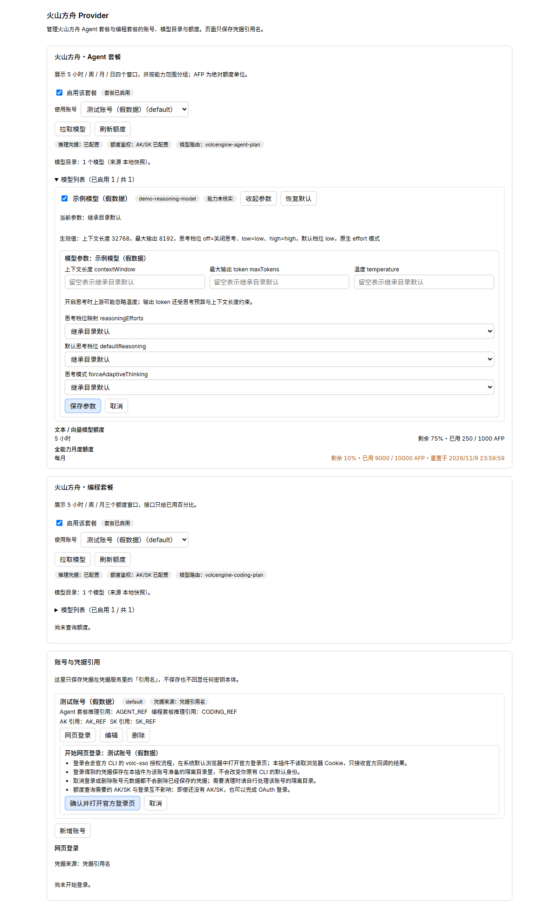

<div align="center">

# 火山方舟 Provider

**在 DeepSeek Harness 中接入火山方舟 Agent Plan 与 Coding Plan。**

账号管理、官方网页登录、模型同步和套餐额度，集中在一个设置页面。

[](https://www.npmjs.com/package/dsh-volcengine-provider)
[](https://github.com/KouzakiUmi/dsh-volcengine-provider/actions/workflows/ci.yml)
[](LICENSE)

[快速开始](#快速开始) · [功能介绍](#功能介绍) · [使用说明](docs/usage.md) · [更新记录](docs/changelog.md)

</div>

## 快速开始

安装最新版本：

```console
dsh plugin --profile web add dsh-volcengine-provider
```

`web` 是示例 Profile，请替换为实际目标；Desktop 使用桌面壳集成的 DSH CLI。也可从 [GitHub Actions](https://github.com/KouzakiUmi/dsh-volcengine-provider/actions/workflows/ci.yml) 或 [Releases](https://github.com/KouzakiUmi/dsh-volcengine-provider/releases) 下载插件包安装。

1. 打开 **设置 → 火山方舟 Provider**，新增账号。
2. 点击 **网页登录**，在官方 ArkCli 页面完成授权；也可填写已有凭据的引用名。
3. 分别为 **Agent 套餐** 和 **编程套餐** 选择账号，点击 **拉取模型**、**刷新额度**。
4. 在 DSH 模型选择器中选择对应路由，开始使用。

网页登录需安装官方 [ArkCli](https://github.com/volcengine/ark-cli)。详细配置见[使用说明](docs/usage.md)。

## 功能介绍



<sub>真实组件离线预览，账号与额度为示例数据。</sub>

### 两套套餐，分别接入

Agent Plan 与 Coding Plan 各有独立的启用开关、账号选择、模型目录和额度状态，可以同时使用。关闭套餐会保留所选账号和模型配置，重新开启即可恢复。

| 套餐 | DSH 模型路由 | 额度窗口 |
|---|---|---|
| Agent Plan | `volcengine-agent-plan` | 5 小时、周、月、日，按能力范围分组 |
| Coding Plan | `volcengine-coding-plan` | 5 小时、周、月 |

### 账号管理与网页登录

支持新增、编辑、删除账号，并为两套套餐分别选择账号。网页登录复用官方 ArkCli OAuth，页面提供登录进度、取消和结果提示；每个账号使用独立的 CLI 身份目录。

已有 API Key 的用户可沿用 DSH 凭据服务或启动环境中的引用名。OAuth 与凭据引用两种方式的配置见[账号与凭据](docs/usage.md#两种接入方式)。

### 拉取套餐模型

从官方套餐目录同步模型，按账号和套餐分别保存。每个模型可单独启用或停用，停用后从 DSH 模型选择器中移除；再次启用会保留原有参数。目录刷新也会保留模型设置。

### 调整模型参数

按账号、套餐和模型保存上下文长度、默认输出 token、温度、思考档位映射及默认档位，支持恢复目录默认值。思考可使用原生 effort 或固定预算模式；两种模式的参数含义不同。未知模型默认采用保守能力，不会被强制设置为 `low`。

单次请求显式填写的参数优先。温度在启用思考时可能被传输层忽略，最终 token 数还受思考预算与上下文约束。详见[模型管理](docs/model-management.md)。

### 查看额度与重置时间

Coding Plan 展示剩余百分比；Agent Plan 同时展示 AFP 已用量、上限和剩余比例。不同能力的额度分组呈现，支持查看重置时间和手动刷新；读取失败时显示具体状态。

## 使用条件

- **DSH Core**：`0.2.1-rc.3`。
- **Node.js**：`>=22.19.0`。
- **ArkCli**：当前按 `1.0.37` 命令契约适配。
- 当前支持国内个人 Agent Plan / Coding Plan。

当前为开发预览。已完成隔离测试、目标 Core 加载和离线界面验证；真实账号 OAuth、在线接口和推理调用的验收状态见[验证记录](docs/validation.md)。

账号删除仅移除插件元数据，已保存的官方 CLI 身份目录会保留。反馈问题时请提供版本、套餐类型和脱敏错误，凭据及授权链接请勿提交。

## 文档与反馈

[使用与常见问题](docs/usage.md) · [开发与发布](docs/development.md) · [接口说明](docs/arkcli-contract.md) · [提交 Issue](https://github.com/KouzakiUmi/dsh-volcengine-provider/issues)

## 许可

[MIT](LICENSE)。第三方版权声明见 [NOTICE](NOTICE)。
