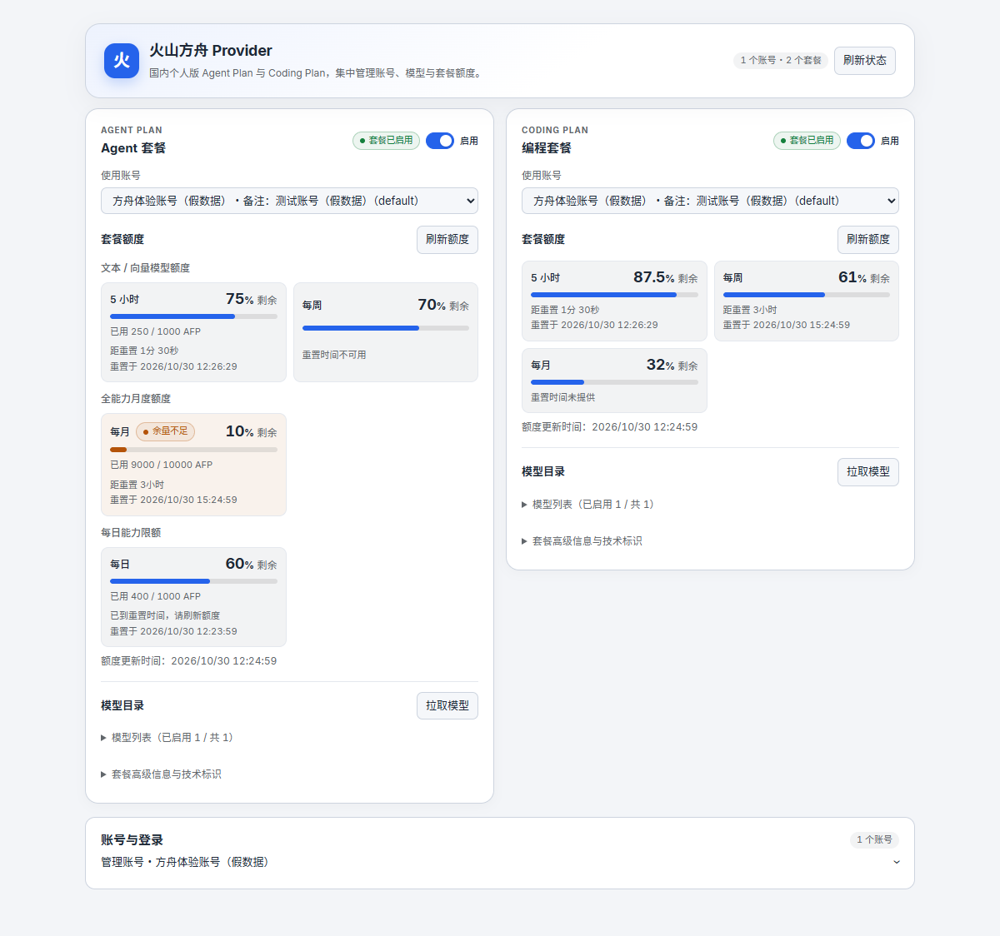

<div align="center">

# 火山方舟 Provider

**在 DeepSeek Harness 中接入火山方舟 Agent Plan 与 Coding Plan。**

账号管理、官方网页登录、模型同步和套餐额度，集中在一个设置页面。

[](https://www.npmjs.com/package/dsh-volcengine-provider)
[](https://github.com/KouzakiUmi/dsh-volcengine-provider/actions/workflows/ci.yml)
[](LICENSE)

[快速开始](#快速开始) · [功能介绍](#功能介绍) · [使用说明](docs/usage.md) · [更新记录](docs/changelog.md)

</div>

## 快速开始

安装最新版本：

```console
dsh plugin --profile web add dsh-volcengine-provider
```

`web` 是示例 Profile，请替换为实际目标；Desktop 使用桌面壳集成的 DSH CLI。也可从 [GitHub Actions](https://github.com/KouzakiUmi/dsh-volcengine-provider/actions/workflows/ci.yml) 或 [Releases](https://github.com/KouzakiUmi/dsh-volcengine-provider/releases) 下载插件包安装。

1. 打开 **设置 → 火山方舟 Provider**。没有账号时直接点击 **网页登录**；已有账号时展开 **管理账号**，再点击 **登录其他账号**。
2. 确认后在自动打开的独立临时 Chrome 窗口完成官方 OAuth 授权，授权结果自动接回；此窗口不共享日常浏览器的扩展或密码管理器。凭据引用接入则使用 **新增账号**。
3. 在账号卡片点击 **用于 Agent套餐 / 用于 编程套餐**，或在套餐卡片分别选择账号与启停。查看模型列表，按需拉取官方目录、刷新额度。
4. 在 DSH 模型选择器中选择对应路由，开始使用。

网页登录需安装官方 [ArkCli](https://github.com/volcengine/ark-cli)。详细配置见[使用说明](docs/usage.md)。

## 功能介绍

套餐区集中显示额度、重置时间和模型入口；已有账号时可在下方展开账号管理。



<sub>真实组件离线预览，使用受控 DSW 主题令牌，账号与额度均为示例数据。另见<a href="docs/client-settings-preview-dark.png">深色预览</a>与<a href="docs/client-settings-preview-mobile-dark.png">390px 窄屏预览</a>。</sub>

### 两套套餐，分别接入

Agent Plan 与 Coding Plan 各有独立的启用开关、账号选择、模型目录和额度状态，可以同时使用。关闭套餐会保留所选账号和模型配置，重新开启即可恢复。

| 套餐 | DSH 模型路由 | 额度窗口 |
|---|---|---|
| Agent Plan | `volcengine-agent-plan` | 5 小时、周、月、日，按能力范围分组 |
| Coding Plan | `volcengine-coding-plan` | 5 小时、周、月 |

### 账号管理与网页登录

支持新增、编辑、删除账号，并为两套套餐分别选择账号。网页登录复用官方 ArkCli OAuth，页面提供登录进度、取消和结果提示；每个账号使用独立的 CLI 身份目录。

已有 API Key 的用户可沿用 DSH 凭据服务或启动环境中的引用名。OAuth 与凭据引用两种方式的配置见[账号与凭据](docs/usage.md#两种接入方式)。

### 拉取套餐模型

从官方套餐目录同步可用模型清单，按账号和套餐分别保存。能力参数依据官方 Plan Pi 文档和官方目录固化，显式匹配别名与版本，旧缓存默认值随快照更新，手动覆盖保留；来源与冲突见[能力参数](docs/model-capabilities.md)。每个模型可独立启停，目录刷新不清空设置；Auto/未知模型保守标记。

设置页和模型选择器使用友好名称，原始调用 ID 可在模型技术详情中查看。模型卡片在名称旁展示消耗倍率与限时折扣，并汇总视觉、思考、上下文和输出能力；倍率来源与 Coding Plan 的参考语义见[能力参数](docs/model-capabilities.md#消耗倍率)。查看[模型卡片预览](docs/client-settings-preview-models.png)与[模型与思考配置预览](docs/client-model-thinking-preview.png)。

### 调整模型参数

按账号、套餐和模型管理图片输入、工具调用、上下文长度、默认输出 token、温度及思考档位，支持恢复目录默认值。图片覆盖只影响本地能力声明；工具调用关闭时保留历史记录，但不再允许新的工具调用。当前通道不支持直接传入音频或视频。思考方式与官方资料中的差异见[思考参数核对表](docs/model-thinking-audit.md)。

单次请求显式填写的参数优先。温度在启用思考时可能被传输层忽略，最终 token 数还受思考预算与上下文约束。详见[模型管理](docs/model-management.md)。

### 查看额度与重置时间

Coding Plan 展示剩余百分比；Agent Plan 同时展示 AFP 已用量、上限和剩余比例。不同能力的额度分组呈现；接口提供重置时间时显示倒计时，未提供时不猜测。支持手动刷新，读取失败时显示具体状态。

## 使用条件

- **DSH Core**：`0.2.1-rc.5`。
- **Node.js**：`>=22.19.0`。
- **ArkCli**：当前按 `1.0.37` 命令契约适配；网页登录仅开放已核验的 Windows ArkCli `1.0.37`，其他平台/版本在登录前拒绝。
- **Chrome**：网页登录需已安装 Google Chrome；插件的 `playwright-core` 依赖负责独立临时窗口，不下载浏览器。
- 当前支持国内个人 Agent Plan / Coding Plan。

当前为开发预览。已完成隔离测试、目标 Core 加载、离线界面及 Windows 真实同设备 OAuth/双套餐临时绑定验收；在线额度、推理调用和生产安装的边界见[验证记录](docs/validation.md)。

账号删除仅移除插件元数据，已保存的官方 CLI 身份目录会保留。反馈问题时请提供版本、套餐类型和脱敏错误，凭据及授权链接请勿提交。

## 文档与反馈

[使用与常见问题](docs/usage.md) · [开发与发布](docs/development.md) · [接口说明](docs/arkcli-contract.md) · [提交 Issue](https://github.com/KouzakiUmi/dsh-volcengine-provider/issues)

## 许可

[MIT](LICENSE)。第三方版权声明见 [NOTICE](NOTICE)。
